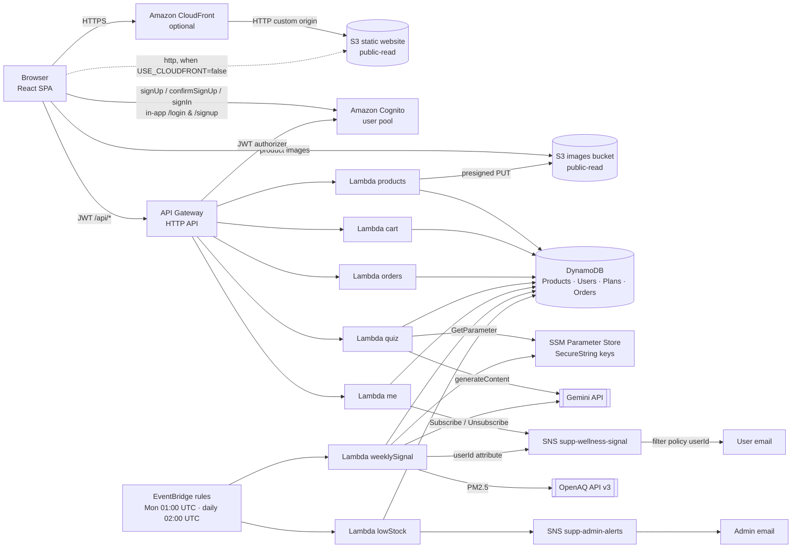

# NutriMate — AI Supplement Shop on AWS

A full-stack supplement e-commerce site (Thai UI) built for a university AWS group project.
This README is a **step-by-step guide that another student group can follow from zero** to deploy and test the app.

---

## 1. What the app does

| Feature | What the user sees |
|---|---|
| **Shop** (`/`) | 12 supplements with category / price filters, search, sorting, `+ ตะกร้า` |
| **Lifestyle quiz** (`/quiz`) | 6-step questionnaire (body, sleep, work, food, exercise/stress, goals & health) |
| **AI result** (`/result`) | **Google Gemini** writes a lifestyle summary, recommends up to 3 products from the shop with *why* and *how to take*, plus 3 lifestyle tips. Shows a "see a doctor first" banner when needed |
| **Cart → Order → History** | Cart stored per user, simulated checkout (shipping ฿40), order numbers `#NM-0001…`, stock is reduced, re-order button |
| **Wellness Signal** (weekly email) | Every **Monday 08:00 (Bangkok)** an automated job reads the latest **PM2.5** for the user's city (**OpenAQ API**), asks Gemini for a 3-line note (air quality, one tip, refill reminder if the last order was > 25 days ago) and emails it via **SNS** |
| **Low-stock alert** | Every day 09:00 an email to the admin lists products with stock < 10 |
| **Admin** (`/admin`) | Add products, upload product images (presigned S3 URL), edit stock — only for the Cognito `admin` group |

Privacy: the AI only receives the questionnaire answers and the product list — **never the name, email or user id**. API keys are kept in SSM Parameter Store and read at runtime; they are never in code, env files or Git.

---

## 2. Architecture



Everything is defined in one AWS SAM template: [`backend/template.yaml`](backend/template.yaml). Region: **us-east-1 (N. Virginia)** — the region used by AWS Academy Learner Lab.

---

## 3. AWS services used (counted for the assessment)

| # | Service | Used for |
|---|---|---|
| 1 | **Amazon S3** | Static website hosting for the React app (public-read), public-read bucket for product images (direct S3 URLs) |
| 2 | **Amazon CloudFront** | HTTPS in front of the S3 **website endpoint** (custom origin, no OAC/OAI), SPA fallback 403/404 → `/index.html`. Optional: `USE_CLOUDFRONT=false` skips it |
| 3 | **Amazon Cognito** | User pool (email + password, email verification code), `admin` group. The app has its own Thai `/login` and `/signup` pages (Amplify `signUp` / `confirmSignUp` / `signIn`) — no hosted UI |
| 4 | **Amazon API Gateway (HTTP API)** | `/api/*` routes, JWT authorizer, CORS |
| 5 | **AWS Lambda** | 7 Node.js 22 functions: products, cart, orders, quiz, me, weeklySignal, lowStock |
| 6 | **Amazon DynamoDB** | 4 on-demand tables: Products, Users, Plans, Orders |
| 7 | **Amazon EventBridge** (scheduled rules) | `cron(0 1 ? * MON *)` UTC = Monday 08:00 Bangkok → weeklySignal; `cron(0 2 * * ? *)` UTC = 09:00 Bangkok → lowStock |
| 8 | **Amazon SNS** | `supp-wellness-signal` (per-user email subscriptions with filter policy), `supp-admin-alerts` |
| 9 | **AWS Systems Manager Parameter Store** | `/supp/gemini-api-key`, `/supp/openaq-api-key` (SecureString) |

Not counted but used: IAM (the existing Learner Lab `LabRole` — the stack creates no IAM roles or policies), CloudWatch Logs (every Lambda), CloudFormation (via SAM).
External APIs: **Google Gemini API** (AI) and **OpenAQ API v3** (PM2.5).

**Level 4 (automated + integrated):** the Wellness Signal runs on a schedule with no human action and chains EventBridge → Lambda → DynamoDB → OpenAQ → Gemini → SNS → email.

---

## 4. Prerequisites

1. **An AWS Academy Learner Lab** (see section 5). In a normal AWS account you would first need an IAM role named `LabRole` that Lambda can assume, with access to DynamoDB, S3, SNS, SSM and CloudWatch Logs.
2. **A Gemini API key** — go to <https://aistudio.google.com/app/apikey> → *Create API key*. (Free tier is enough for a demo. Note: on the free tier Google may use prompts to improve its products — we only send anonymous quiz answers.)
3. **An OpenAQ API key** — create a free account at <https://explore.openaq.org/register>, then copy the key from your account settings page.
4. **An email address** for admin alerts (you must be able to click the confirmation email).
5. The code in a Git repository (fork/clone this repo), or as a zip file.

You do **not** need anything installed on your own computer — everything runs in **AWS CloudShell**, which already has the AWS CLI, SAM CLI, Node.js, npm and git.

---

## 5. Running in AWS Academy Learner Lab

This project is built to deploy into an **AWS Academy Learner Lab** account, which has a few special rules.

1. **Start the lab first.** AWS Academy → your course → *Modules* → *Launch AWS Academy Learner Lab* → **Start Lab**. Wait until the dot next to **AWS** turns green (1–2 minutes), then click **AWS** to open the console. All console, CloudShell and CLI access only works while the lab is running.
2. **Region us-east-1.** Learner Lab only lets you use **US East (N. Virginia) us-east-1** (and us-west-2). This project uses **us-east-1** everywhere: `deploy.sh` sets it, and all commands in this README pass `--region us-east-1`. Check the console region (top right) before opening CloudShell.
3. **LabRole instead of new IAM roles.** Learner Lab does not allow creating IAM roles or policies, so the template creates **none**:
   - every Lambda runs as the existing **`LabRole`** (`arn:aws:iam::<account-id>:role/LabRole`);
   - the weekly / daily jobs are **EventBridge rules** that call Lambda through a resource-based permission (no role);
   - API Gateway also calls Lambda through resource-based permissions.
   - **No CloudFront Origin Access Control** (Learner Lab denies `cloudfront:CreateOriginAccessControl`): the site bucket is a **public S3 static website** and CloudFront uses its website endpoint as a normal HTTP origin. Product images are public-read objects served directly from S3.
   - **No Cognito hosted UI / domain**: sign-up and sign-in happen on the app's own `/login` and `/signup` pages.

   Check that LabRole exists:
   ```bash
   aws iam get-role --role-name LabRole --query Role.Arn --output text
   ```
4. **If CloudFront is not allowed in your lab**, deploy without it: `USE_CLOUDFRONT=false ADMIN_EMAIL=you@example.com ./deploy.sh`. The site URL is then the S3 website URL (`http://<bucket>.s3-website-us-east-1.amazonaws.com`, HTTP only). Login still works because the password is sent to Cognito over HTTPS, but prefer CloudFront (HTTPS) when you can.
5. **Sessions expire, resources stay.** A lab session lasts about 4 hours. When the timer reaches 0 your console/CloudShell session ends (you will see `ExpiredToken` errors), but the deployed stack, tables, buckets, CloudFront, SSM parameters and data **stay**. Click **Start Lab** again to continue; your CloudShell home folder (with the cloned repo) is usually still there — if not, clone again and re-run `./deploy.sh` (it only updates what changed).
6. **Before a demo** start the lab, open the site once, and if the Monday job did not run while the lab was stopped, trigger it manually (section 8).
7. **Budget.** Learner Lab has a fixed credit; this app costs almost nothing (section 10), but delete the stack when you are finished (section 9).

---

## 6. Deploy step by step (AWS CloudShell)

### 6.1 Open CloudShell in the right region
1. Sign in to the AWS Console.
2. Top-right region selector → **US East (N. Virginia) us-east-1**.
3. Click the CloudShell icon (`>_`) in the top bar and wait for the prompt.

Check the tools (Node.js must be 20 or newer):
```bash
aws --version
sam --version
node -v
```

### 6.2 Get the code into CloudShell
Either clone your repository:
```bash
git clone https://github.com/<your-team>/<your-repo>.git supp-shop
cd supp-shop
```
or upload a zip (CloudShell **Actions → Upload file**) and:
```bash
unzip supp-shop.zip -d supp-shop && cd supp-shop
```
Make the script executable:
```bash
chmod +x deploy.sh
```

### 6.3 Store the API keys in SSM Parameter Store (once)
`read -s` hides the key while you paste it and keeps it out of the shell history:
```bash
read -s -p "Gemini API key: " KEY && echo && \
aws ssm put-parameter --name /supp/gemini-api-key --type SecureString --value "$KEY" --overwrite --region us-east-1 && unset KEY

read -s -p "OpenAQ API key: " KEY && echo && \
aws ssm put-parameter --name /supp/openaq-api-key --type SecureString --value "$KEY" --overwrite --region us-east-1 && unset KEY
```
Check (shows names only, not values):
```bash
aws ssm describe-parameters --region us-east-1 --query "Parameters[?starts_with(Name,'/supp/')].Name"
```

### 6.4 Deploy everything with one command
```bash
ADMIN_EMAIL=your.name@example.com ./deploy.sh
```
What the script does:
1. Checks both SSM parameters exist (if not, prints the exact `put-parameter` commands and stops).
2. If a previous first deploy failed (stack status `ROLLBACK_COMPLETE`), empties its buckets, deletes the stack and waits until it is gone.
3. `sam build` + `sam deploy` the stack **`supp-shop`** (first time ≈ 5–10 minutes with CloudFront, ≈ 2–3 minutes without).
4. Reads the stack outputs and writes `frontend/.env.production`.
5. Builds the React app, uploads it to the site bucket, invalidates CloudFront (if used), deletes `node_modules` (CloudShell only has ~1 GB).
6. Seeds the 12 products into DynamoDB (skipped if products already exist).
7. Prints the **site URL** and next steps.

Without CloudFront (if your lab blocks it):
```bash
USE_CLOUDFRONT=false ADMIN_EMAIL=your.name@example.com ./deploy.sh
```

Optional: change the Gemini model (default `gemini-flash-latest`, an alias for Google's current Flash model):
```bash
GEMINI_MODEL=gemini-2.5-flash ADMIN_EMAIL=your.name@example.com ./deploy.sh
```
You can re-run `./deploy.sh` any time after changing code — it updates the stack and re-uploads the site.

### 6.5 After the deploy
1. **Confirm the admin email:** open the "AWS Notification - Subscription Confirmation" email sent to `ADMIN_EMAIL` and click *Confirm subscription*.
2. **Open the site URL** printed at the end (`https://dxxxxxxxx.cloudfront.net`, or `http://<bucket>.s3-website-us-east-1.amazonaws.com` without CloudFront).
3. **Create an account:** click `เข้าสู่ระบบ` → `สมัครสมาชิก` → enter email + password (at least 8 characters with a lowercase letter and a number) → type the 6-digit code from the verification email → you are signed in.
4. **Make yourself admin** (the script prints this command with your pool id filled in):
   ```bash
   aws cognito-idp admin-add-user-to-group --region us-east-1 \
     --user-pool-id <UserPoolId> --group-name admin --username <your-email>
   ```
   Sign out and sign in again so the new group is in your token. The avatar menu now shows `จัดการสินค้า (แอดมิน)`.

To see all outputs again:
```bash
aws cloudformation describe-stacks --stack-name supp-shop --region us-east-1 --query "Stacks[0].Outputs" --output table
```

---

## 7. How to test each feature

| # | Feature | Steps | Expected |
|---|---|---|---|
| 1 | Public shop | Open the site without signing in. Use category / price filters, search `คอลลาเจน`, sort by price | Product grid updates; `ไม่พบสินค้าที่ตรงกับตัวกรอง` when nothing matches |
| 2 | Sign up / sign in | Click `+ ตะกร้า` while signed out, or `เข้าสู่ระบบ` → `สมัครสมาชิก`. Try a wrong password and a wrong code too | `/login` → `/signup` → code step → back to the page you came from; Thai error messages for wrong password/code |
| 3 | Cart | Click `+ ตะกร้า` on a few products | Toast `เพิ่มลงตะกร้าแล้ว`, badge in the navbar increases; `/cart` shows the items, `−`/`+`/`ลบ` work |
| 4 | Quiz + AI | Go to `วิเคราะห์ไลฟ์สไตล์`, answer the 6 steps, tick consent, click `ส่งให้ AI วิเคราะห์ →` | Loading `AI กำลังวิเคราะห์…`, then the result page with summary, ≤ 3 products, tips |
| 5 | Safety rule | Retake the quiz and type something in `ยาที่ทานประจำ…` (or choose pregnancy `ใช่`) | Orange banner `ควรปรึกษาแพทย์หรือเภสัชกรก่อนทานอาหารเสริม` |
| 6 | Order | On `/cart` click `สั่งซื้อ` | `สั่งซื้อสำเร็จ`; cart is empty; `/history` shows `#NM-000x`; stock in `/admin` decreased |
| 7 | History | `/history` → `รายละเอียด` → `สั่งซื้ออีกครั้ง` | Same items are added to the cart |
| 8 | Weekly signal opt-in | On `/result` turn on `สัญญาณสุขภาพรายสัปดาห์`, choose a city | Message `กรุณายืนยันอีเมลจาก AWS…`; confirm the AWS email; navbar chip shows `· เปิด` |
| 9 | Weekly signal email | Section 8 below | Email with PM2.5, a tip and refill reminder |
| 10 | Admin | Avatar → `จัดการสินค้า (แอดมิน)` → add a product with an image | Product appears in the shop with the uploaded image (direct S3 URL `https://<images-bucket>.s3.us-east-1.amazonaws.com/images/...`) |
| 11 | Low-stock alert | In `/admin` set a product's stock to e.g. `5` → `บันทึก`. Then Lambda console → `supp-shop-LowStockFunction-…` → **Test** with `{}` | Admin email `NutriMate low stock alert` (also arrives automatically every day at 09:00) |

Where to look when something fails: **CloudWatch → Log groups → `/aws/lambda/supp-shop-<Name>Function-…`**.
The quiz Lambda logs `plan created` with `"source":"gemini"` or `"source":"fallback"` (fallback = Gemini failed twice and the rule-based plan was used).

---

## 8. Run the weekly job manually (for the demo)

1. AWS Console → **Lambda** → function `supp-shop-WeeklySignalFunction-xxxx`.
2. Tab **Test** → *Create new event* → name `demo`, event JSON:
   ```json
   {}
   ```
   (or `{"userId": "<cognito sub>"}` to send to one user only — the sub is in Cognito → Users).
3. Click **Test**. The result shows a summary, for example:
   ```json
   { "msg": "weeklySignal summary", "usersProcessed": 1, "emailsPublished": 1, "geminiNotes": 1,
     "cities": { "กรุงเทพมหานคร": 23.4 }, "failures": 0 }
   ```
4. Check the inbox of the subscribed user (the subscription must be **confirmed** first).

The schedules are visible in **Amazon EventBridge → Rules** (`supp-shop-weekly-signal`, `supp-shop-low-stock`). EventBridge cron is in **UTC**: `cron(0 1 ? * MON *)` = Monday 08:00 in Bangkok (UTC+7).

---

## 9. Delete everything

```bash
REGION=us-east-1
out() { aws cloudformation describe-stacks --stack-name supp-shop --region $REGION --query "Stacks[0].Outputs[?OutputKey=='$1'].OutputValue" --output text; }

# 1. Buckets must be empty before the stack can delete them
aws s3 rm "s3://$(out SiteBucket)" --recursive
aws s3 rm "s3://$(out ImagesBucket)" --recursive

# 2. Delete the stack (takes a few minutes if CloudFront is used)
sam delete --stack-name supp-shop --region $REGION --no-prompts

# 3. Delete the API keys
aws ssm delete-parameter --name /supp/gemini-api-key --region $REGION
aws ssm delete-parameter --name /supp/openaq-api-key --region $REGION
```
SAM also created a deployment bucket named `aws-sam-cli-managed-default-samclisourcebucket-…`; empty and delete it in the S3 console (or delete the `aws-sam-cli-managed-default` stack) if you no longer use SAM.

---

## 10. Cost notes

For a class demo this should cost **≈ $0** — almost everything is inside the AWS Free Tier or pay-per-request:

| Service | Notes |
|---|---|
| Lambda, API Gateway HTTP API | Free tier: 1M requests/month each (API GW free for 12 months), then ~$1 per million |
| DynamoDB on-demand | Pay per request; a demo is a few cents at most. 25 GB storage free |
| S3 + CloudFront | A few MB of files; S3 website requests cost fractions of a cent; CloudFront always-free tier is 1 TB transfer/month |
| Cognito (Essentials) | Free up to 10,000 monthly active users |
| SNS | First 1,000 email notifications/month free |
| EventBridge scheduled rules | Free (scheduled events are not charged) |
| SSM Parameter Store | Standard parameters are free |
| Gemini API / OpenAQ | Free tiers are enough for a demo (watch Gemini rate limits) |

Tips: create an **AWS Budget** with an email alert at $5; delete the stack when the project is graded.

---

## 11. Local development

### Mock mode (no AWS needed)
```bash
cd frontend
npm install
npm run dev:mock          # same as: VITE_USE_MOCK=true npm run dev
```
Open <http://localhost:5173>. A mock signed-in admin user, the 12 products, a 2-item cart, 3 past orders and the sample AI plan from the design files are loaded in memory (reset on reload). The quiz returns a rule-based "mock AI" plan.

### Against the deployed backend
After a deploy, copy `frontend/.env.production` to `frontend/.env.local` and run `npm run dev`. `http://localhost:5173` is already allowed in API CORS, and sign-in works locally because it uses the in-app login pages.

### Backend checks
```bash
cd backend
npm install
npm test               # planner safety-rule tests (no AWS needed)
sam validate --lint    # template validation (in CloudShell)
```

---

## 12. Project structure

```
├─ deploy.sh                 one-command deploy (CloudShell)
├─ design/app/*.dc.html      UI mockups (reference only, not deployed)
├─ frontend/                 React 18 + Vite + TypeScript + Tailwind + React Router + Amplify v6 (Auth)
│  └─ src/
│     ├─ pages/              Shop, Quiz, Result, Cart, History, Admin, Login, Signup
│     ├─ components/         Navbar, ProductCard, ProductImage, Icons, ui (PageHeader, pills, toast…)
│     ├─ api/                types, http client (real), mock implementation
│     ├─ auth/               Amplify signUp / confirmSignUp / signIn / signOut (no hosted UI)
│     ├─ state/              cart / settings / products store
│     └─ mock/               mock data (same as the design files)
└─ backend/
   ├─ template.yaml          AWS SAM template — every AWS resource
   ├─ src/                   Lambda handlers (Node.js 22, ES modules, AWS SDK v3)
   │  ├─ products.mjs cart.mjs orders.mjs quiz.mjs me.mjs weeklySignal.mjs lowStock.mjs
   │  └─ lib/                db, http, ssm, gemini, openaq, planner, catalog
   └─ scripts/               seed.mjs (12 products), test-planner.mjs
```

### API routes (prefix `/api`)
| Route | Auth | Lambda |
|---|---|---|
| `GET /api/products` (`cat`, `q`, `price`=`lt300`/`mid`/`gt500`, `sort`=`rec`/`low`/`high`) | public | products |
| `GET /api/products/{id}` | public | products |
| `POST /api/products` (create, or update when `productId` exists) | admin | products |
| `POST /api/uploads` → `{uploadUrl, imageUrl}` | admin | products |
| `GET` / `PUT /api/cart` | user | cart |
| `POST` / `GET /api/orders` | user | orders |
| `POST /api/quiz`, `GET /api/plans/latest` | user | quiz |
| `GET` / `PUT /api/me` | user | me |

---

## 13. Design decisions and notes

- **No IAM resources in the template** (Learner Lab rule): every Lambda sets `Role: arn:aws:iam::${AWS::AccountId}:role/LabRole`; schedules are plain `AWS::Events::Rule`s that invoke Lambda through `AWS::Lambda::Permission` (resource-based, no role); API Gateway invokes Lambda the same way. Trade-off: LabRole is broad, so the functions are not least-privilege.
- **Public S3 website instead of OAC** (Learner Lab denies `cloudfront:CreateOriginAccessControl`): the site bucket has static website hosting (`IndexDocument`/`ErrorDocument` = `index.html`), Block Public Access off and a public `s3:GetObject` bucket policy. CloudFront (optional, `UseCloudFront` parameter) points at the **website endpoint** as an HTTP-only custom origin and adds HTTPS + the SPA fallback. Only build output (HTML/JS/CSS) is in this bucket, so public read is fine.
- **In-app login instead of the Cognito hosted UI**: `/login` and `/signup` call Amplify v6 `signUp`, `confirmSignUp`, `signIn` and `signOut`. The app client allows `USER_PASSWORD_AUTH`, which needs no browser crypto, so sign-in works on the http S3 website URL too; the password always travels over HTTPS to the Cognito API. Cognito's built-in email sender is limited to ~50 emails/day — fine for a demo.
- The SPA sends the Cognito **ID token** (it carries `email` and `cognito:groups`); the HTTP API JWT authorizer checks issuer + audience (app client id). Admin checks are done in the Lambda.
- **Cart** = the Orders item with `orderId = "CART"`. **Order numbers** come from an atomic counter item (`userId = "#COUNTER"`) in the Orders table. Placing an order is a DynamoDB transaction (save order + reduce stock with `stock >= qty` condition + delete cart).
- **AI safety rules are enforced in code** (`backend/src/lib/planner.mjs`): answers are whitelisted, unknown `productId`s are dropped, max 3 items, `needsDoctor` forced when medication/conditions text is filled or pregnancy = `ใช่`; invalid JSON → 1 retry → rule-based plan (goal → category).
- **OpenAQ**: per city we look up stations measuring PM2.5 within 25 km of the city centre (`/v3/locations`) and read the nearest station with a reading from the last 3 days (`/v3/locations/{id}/latest`). This happens **once per distinct city per run** and is cached for the run. No recent data → the email says so.
- **SNS per-user emails**: every user's email subscription to `supp-wellness-signal` has the filter policy `{"userId":["<sub>"]}` and each published message carries a `userId` attribute, so each user only receives their own note. Emails end with the AI disclaimer and how to turn the email off.
- **Product images** are public-read objects in the images bucket, served by their direct S3 URL (`https://<bucket>.s3.us-east-1.amazonaws.com/images/products/<uuid>.<ext>`). Bucket CORS allows `PUT` from any origin so the admin page works on CloudFront, the S3 website URL and localhost; uploads still need a 5-minute presigned URL issued only to admins.
- **Gemini model** is the template parameter `GeminiModel` (default `gemini-flash-latest`). Change it with `GEMINI_MODEL=... ./deploy.sh` if Google renames models.
- The Lambdas use the AWS SDK v3 that ships with the Node.js 22 runtime; only the S3 client + presigner are bundled (for presigned uploads).
- UI behaviour choices not fixed by the mockups: the quiz starts at step 1 and is pre-filled from your latest plan; the newest order row in History starts expanded (as in the mockup); `ดูรายละเอียดสินค้า` opens the shop filtered to that product; `สั่งซื้ออีกครั้ง` adds the items and opens the cart; the Admin page also lets admins edit stock inline (handy for the low-stock demo).

## 14. Troubleshooting

| Problem | Fix |
|---|---|
| `deploy.sh: /usr/bin/env: 'bash\r'` | The file got Windows line endings: `sed -i 's/\r$//' deploy.sh` |
| Deploy fails on `CreateOriginAccessControl` or `ManagedLoginBranding` | You are using an old template — pull the latest code (it creates neither) |
| Deploy fails on CloudFront (`AccessDenied` for `cloudfront:*`) | Re-run with `USE_CLOUDFRONT=false`; `deploy.sh` deletes a `ROLLBACK_COMPLETE` stack automatically first |
| Bucket policy fails with `AccessDenied` / "public policies are blocked" | The account-level S3 Block Public Access is on. Turn it off for the account (S3 console → *Block Public Access settings for this account*) if your lab allows it, or ask your instructor |
| Sign-up email (verification code) never arrives | Check spam; Cognito's default sender allows ~50 emails/day. In the Cognito console you can also confirm the user manually (*Users → user → Confirm account*) |
| API calls fail with a CORS error | You opened the site on a URL other than the `SiteUrl` output or `http://localhost:5173` (API CORS allows only those) |
| Quiz always returns a generic plan | Check the QuizFunction logs: wrong Gemini key (`HTTP 400/403`) or model name (`HTTP 404`) — fix the key in SSM or redeploy with `GEMINI_MODEL=...` |
| No weekly email | The SNS subscription is still *pending confirmation*; check spam and click the AWS confirm link |
| Weekly email says no PM2.5 data | OpenAQ had no fresh reading near that city (or the key is wrong — see WeeklySignalFunction logs) |
| Admin page says "สำหรับผู้ดูแลระบบเท่านั้น" | Add your user to the `admin` group, then sign out and in again |
| `ExpiredToken` / `InvalidClientTokenId` in CloudShell | The Learner Lab session ended. Start the lab again, reopen the console from the lab page and open a new CloudShell |
| `not authorized to perform: iam:CreateRole` | You are deploying an old template version — pull the latest code (this template creates no IAM roles) |
| A resource fails with `AccessDenied` / `explicit deny` | Learner Lab blocks some services/features; read the lab's **Readme** for the allowed list and tell your instructor |
| Bucket not empty when deleting | Run the `aws s3 rm … --recursive` commands in section 9 first |
